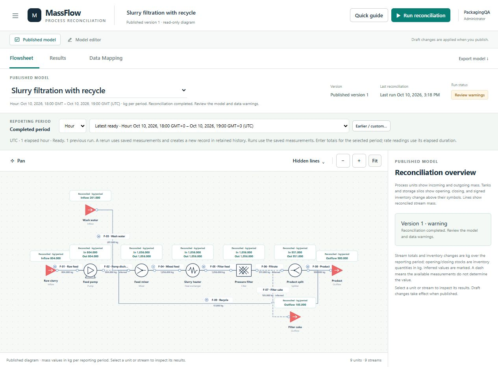

# openReconcile

**Visual mass balance reconciliation for industrial processes.**

Build a plant flowsheet, reconcile measured and unmeasured material flows, and inspect the results directly on your process diagram. openReconcile is an MIT-licensed web application that runs on a company's own server with Docker.

[Features](#features) · [Quickstart](#quickstart) · [First reconciliation](#run-your-first-reconciliation) · [Documentation](#documentation) · [Contributing](#development-and-contributing)



*The supplied slurry filtration reference model, running in the standalone application. Values come from its included example readings; see the [independent analytical check](examples/showcase-model.md). The web interface is named MassFlow.*

## Features

| Capability | What you can do |
| --- | --- |
| **Visual process modeling** | Choose a model from the published or editing gallery, then drag equipment symbols onto its canvas and connect their ports. Model pumps, valves, mixers, filters, tanks, and other units; use boundary triangles, crossing bridges, and hide/restore controls to keep diagrams readable. |
| **Mass balance reconciliation** | Fit readings according to their uncertainty while enforcing conservation, nonnegative flows, and optional tank capacities. Infer quantities where the available evidence uniquely determines them and flag unresolved quantities. |
| **Physical and virtual meters** | Enter readings with units and uncertainty, or calculate a virtual reading with arithmetic and references such as `[RAW FEED] + [WASH WATER]`. Shared-reference uncertainty is propagated into the reconciliation. |
| **Tanks and storage** | Reconcile opening and closing inventories, net accumulation, and transfers. Use mass, volume, or level readings with configured density and geometry. |
| **Drafts and published models** | Edit and test a working draft separately from its active publication. Show reconciled stream masses, unit throughput, inventories, and accumulation on the published diagram. |
| **Reporting periods and data quality** | Select completed hours, days, shifts, or batches and rerun previous periods. Configure time zones, cutoffs, and late-data allowance; apply reading-age, quality-flag, coverage, integration, and totalizer rules to connected inputs. |
| **SQL and PI input/output** | Read/write SQL Server, PostgreSQL, or MySQL through the [SQL gateway](connectors/sql-gateway/README.md), or connect to plant historian tags through [PI Web API](docs/pi-web-api.md). Map inputs and deliver observable reconciled results to configured destinations. |
| **Models and permissions** | Manage multiple models with viewer, operator, editor, and administrator roles. Assign model access, lock editing or unpublishing, and control deletion/restoration. |
| **Schedules and audit history** | Run published models automatically on an internal server, without an open browser. Configure frequency, reporting periods, and source selections; search recorded changes with configurable audit retention. |
| **Portable models and results** | Import/export models as JSON and export reconciliation results as CSV. Start from supplied reference models with independently calculated expected results. |

## Quickstart

### 1. Install with Docker

Use a Linux server or VM with **Docker Engine and the Docker Compose plugin**. Docker Desktop with Linux containers also works for local evaluation. These commands use a Linux shell; run them from an interactive terminal.

```sh
git clone https://github.com/SavaStosic3/openReconcile.git
cd openReconcile
cp deploy/.env.example .env
chmod 600 .env
docker compose build --pull
docker compose run --rm app node deploy/cli.mjs setup --username PlantAdmin
docker compose up -d
docker compose ps
```

Setup prompts for a password of at least **12 characters**, with input hidden. Choose your own administrator username if preferred. Each installation starts with an empty workspace and has its own accounts and data.

An extracted repository ZIP can be used instead of cloning. The internal installation requires no ChatGPT account or hosted service; the existing hosted site remains the separate development and testing workspace.

### 2. Sign in

Open **http://localhost:8080** on the server and sign in with the account you created. For a server without a desktop, run this on your workstation:

```sh
ssh -L 8080:127.0.0.1:8080 user@internal-server
```

Then open **http://localhost:8080** on that workstation. The default container port is restricted to the server's loopback interface.

For access by colleagues, configure `PUBLIC_ORIGIN`, internal DNS, and a trusted HTTPS reverse proxy using the [company deployment guide](docs/self-hosting.md#configure-company-access-with-https).

### 3. Keep your workspace

Accounts, models, permissions, schedules, audit records, and retained results persist in the **`openreconcile_data`** Docker volume. Keep that volume when replacing or upgrading the container. Follow the [backup and restore instructions](docs/self-hosting.md#persistent-data-and-backups) before upgrades.

### 4. Enable scheduled reconciliation

Publish a model, open **☰ → Model Management**, choose its frequency, reporting period, and optional input/output sources, then enable and save the schedule. The Docker server checks due schedules every five seconds by default and continues after you sign out or close the browser. It rechecks the configuring account's permissions for each run. On an upgraded installation, save existing enabled schedules once to authorize unattended execution. See [scheduling and recovery](docs/self-hosting.md#unattended-scheduling) for configuration and interrupted-run handling.

## Run your first reconciliation

1. Sign in as the administrator, open **☰ → Edit models**, and select **New model** to open the editor.
2. Choose **Load template → Slurry filtration with recycle** and confirm. The template creates a separate model with equipment, physical meters, a virtual meter, and unmetered streams already connected.
3. Select a completed **Hour** and open **Measurements**. Review the included readings, their units, and one-standard-deviation uncertainties.
4. Select **Test draft reconciliation** and inspect **Results** for fitted values, adjustments, inferred flows, and unit closure.
5. Select **Publish model**, switch to **Published model**, and select **Run reconciliation**. Reconciled values appear beside streams and above process symbols.

For the supplied one-hour readings, the external balance is:

```text
804 kg raw feed + 201 kg wash water = 900 kg product + 105 kg wet filter cake
```

The recycle is internal to the model, and every ordinary process unit closes to zero. The [reference calculation](examples/showcase-model.md) explains the expected adjustments and the informational virtual-meter warning.

Next, choose **Load template → Tanks & storage** in the editor for the separate **Three-tank transfer** model. Its reference hour demonstrates mass, volume, and level inventories, accumulation, and inferred transfers. Compare against its [expected results](examples/storage-showcase-model.md); inventory readings are boundary snapshots and must match the reporting period you select.

To build your own model, drag units onto the canvas, connect their ports, and right-click a stream to configure material properties and a meter. Enter physical readings on **Measurements**, or select **Virtual** and enter a formula. Include every material path across the model boundary. See the [user guide](docs/user-guide.md) for editing, publication, permissions, mapping, and scheduling.

## How reconciliation works

Ordinary units conserve total mass. Tanks and storage conserve mass with accumulation:

```text
incoming mass − outgoing mass = closing inventory − opening inventory
```

The solver minimizes uncertainty-weighted measurement adjustments subject to these balances and supported physical bounds. It accounts for covariance from virtual-meter references and configured inventory endpoint errors. Unmeasured quantities are reported as inferred only when identifiable; unresolved values remain marked as such.

Read the [mathematical scope and assumptions](docs/user-guide.md#mathematical-scope), [storage mathematics](docs/storage-mathematics.md), and both example calculations before applying a model to plant reporting. The methods follow established data-reconciliation mathematics, including [Tamhane & Mah (1985)](https://www.stat.cmu.edu/technometrics/80-89/VOL-27-04/v2704409.pdf).

## Documentation

| Guide | Contents |
| --- | --- |
| [Internal-server installation](docs/self-hosting.md) | Docker, HTTPS, account provisioning, SQL configuration, backups, restore, upgrades, and installation checks. |
| [Using openReconcile](docs/user-guide.md) | Modeling, readings, inventories, virtual meters, publications, permissions, reporting periods, quality rules, and audit history. |
| [SQL gateway](connectors/sql-gateway/README.md) | Driver setup, connection configuration, input/output schemas, boundary snapshots, and quality policies. |
| [PI Web API](docs/pi-web-api.md) | Admin connection setup, encrypted credentials, tag mappings, PI quality, boundary reads, and result delivery. |
| [Filtration reference](examples/showcase-model.md) · [model JSON](examples/showcase-model.json) | A recycle network with physical, virtual, and inferred flows, plus an independent analytical solution. |
| [Storage reference](examples/storage-showcase-model.md) · [model JSON](examples/storage-showcase-model.json) | Three accumulating tanks with independently calculated fitted inventories and transfers. |
| [Storage mathematics](docs/storage-mathematics.md) | Conservation, conversions, covariance, uncertainty, and assumptions. |
| [Development and hosted deployment](docs/development.md) | Local development, hosted authentication/database setup, and verification commands. |
| [Release checklist](RELEASE_CHECKLIST.md) · [Roadmap](ROADMAP.md) | Release validation and remaining capabilities. |

## Current scope

- **Total mass reconciliation.** Equipment symbols do not calculate pump curves, thermodynamics, component balances, or energy balances. Storage conversion assumptions are documented in the mathematics guide.
- **Unattended scheduling for internal installations.** The standalone server runs schedules while the app service is running. The retained ChatGPT testing site continues to use browser-triggered schedules. Missed periods are not replayed automatically. Uncertain connector delivery from a manual or scheduled run pauses that model's automatic schedule until you review the destination and explicitly enable it again.
- **20 retained runs per model.** Use output connectors for long-term reconciliation results; audit retention is configured separately.
- **SQL requires a separate gateway.** CSV result export and JSON model import are available. Configure PI under **Data connectors → PI connection settings**, with encrypted server credentials and separate output bindings. CSV connection-structure import and dedicated SAP/ODBC connectors remain on the roadmap.
- **One internal app instance with local SQLite storage.** High availability and multiple replicas are outside the supplied Docker deployment. Models are limited to 200 nodes and 500 streams.

The reference models and automated checks provide reproducible verification. Validate your actual topology, readings, units, uncertainties, and source data against known company cases before using results for reporting.

## Development and contributing

Changes should include a clear reproduction or expected behavior and appropriate verification, especially for conservation, uncertainty, observability, and reporting-period behavior. Use **Node.js 24** for the full test suite, which also exercises the standalone SQLite runtime. See the [development guide](docs/development.md) for the local environment.

```sh
npm ci
npm test
npm run typecheck
npm run build
```

The [Internal server container workflow](.github/workflows/docker.yml) builds the Docker image and checks login, permissions, both analytical examples, container replacement, and backup restoration. SQL gateway tests have their own setup in the [gateway guide](connectors/sql-gateway/README.md); plant connectivity requires separate verification.

## License

Released under the [MIT License](LICENSE). Third-party dependencies retain their own licenses, including the bundled Sites Vite integration's [MIT attribution](build/sites-vite-plugin.LICENSE).
